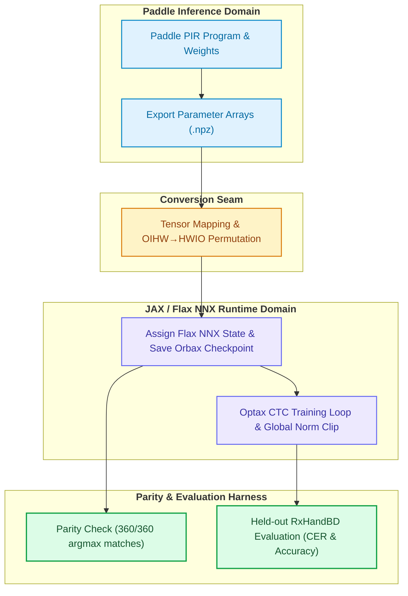

# OCRax: High-Fidelity JAX/Flax Port of PP-OCRv6 for Clinical Handwriting

[](https://www.python.org/downloads/)
[](https://docs.jax.dev/)
[](LICENSE)
[](#convert-checkpoints-and-check-parity)
[](docs/blog.md)

**OCRax** is an open-source research and engineering toolkit that ports Baidu's production-grade [PP-OCRv6](https://arxiv.org/abs/2606.13108) text recognition architecture to **JAX and Flax NNX**. Developed to explore low-latency, privacy-preserving document transcription at the clinical edge, OCRax provides mathematical parity verification, reproducible data manifest generation, fine-tuning recipes, and automated Google Colab workflows on the [RxHandBD](https://doi.org/10.17632/dsb5r6vskg.3) medical handwriting benchmark.

📖 **For an in-depth tutorial and literature review**, see the comprehensive article: [Building Efficient OCR for Clinical Handwriting with JAX](docs/blog.md).

---

## Key Results on RxHandBD Benchmark

Evaluating models on 1,115 held-out physician prescription crops from RxHandBD demonstrates the efficiency and accuracy of compact visual sequence models compared to multi-billion parameter vision-language models:

| Model | Parameter Scale | Decoder Type | CPU Latency / Throughput | Character Error Rate (CER) ↓ | Raw Exact Match ↑ | Normalized Exact Match ↑ |
| :--- | :--- | :--- | :--- | :---: | :---: | :---: |
| **PaddleOCR-VL-0.9B** (Pretrained) | ~900M | Causal Autoregressive LM | 2,011.67 ms (0.50 img/s) | 42.44% | 23.77% | 27.80% |
| **PP-OCRv6 medium** (Zero-Shot JAX) | 34.5M | Non-Autoregressive CTC | 60.89 ms (16.42 img/s) | 34.48% | 28.16% | 32.65% |
| **PP-OCRv6 medium** (Fine-Tuned JAX) | 34.5M | Non-Autoregressive CTC | **52.59 ms (19.01 img/s)** | **26.20%** | **36.59%** | **44.93%** |

- **Strict Parity**: Converted all 161 parameter tensors from Paddle to JAX Flax NNX with **360 of 360** matching timestep argmax tokens (`atol=2e-4, rtol=2e-4`).
- **Domain Adaptation**: Fine-tuning improved Character Error Rate by **-8.28 percentage points** and Normalized Exact Match by **+12.28 percentage points**.
- **Edge Efficiency**: Fine-tuned PP-OCRv6 processes crops **~38× faster on commodity CPU** than 0.9B-parameter VLMs, decoding a 50-word prescription sheet in ~2.5 seconds instead of 1.5 minutes.

---

## System Architecture

OCRax decouples weight conversion, numerical verification, and fine-tuning across clear framework boundaries:



---

## Quick Start

### 1. Requirements

- Conda with **Python 3.13.x**.
- A JAX-compatible CPU, Apple Silicon (Metal/MPS), or NVIDIA GPU runtime.
- Optional: PaddlePaddle and PaddleOCR for original model export and parity verification.
- Optional: Google Cloud authentication and Colab CLI for remote accelerator training.

### 2. Installation

Clone the repository and install OCRax in editable mode:

```bash
git clone https://github.com/ghif/ocrax.git
cd ocrax

conda create -n ocrax python=3.13 -y
conda activate ocrax

python -m pip install --upgrade pip
python -m pip install -e .
```

Install optional dependency groups based on your workflow:

```bash
# For Paddle export, inference, and cross-framework parity
python -m pip install -e ".[paddle]"

# For Google Cloud Storage and remote Colab execution
python -m pip install -e ".[cloud]"

# Install all dependencies
python -m pip install -e ".[paddle,cloud]"
```

Verify that the CLI commands are registered:

```bash
ocrax-train --help
ocrax-evaluate-jax --help
```

> **Note**: On machines where JAX attempts to select an unavailable accelerator backend, set `JAX_PLATFORMS=cpu` before running commands.

---

## Core Workflows

### 1. Prepare RxHandBD Manifests

The RxHandBD dataset should be structured as follows:

```text
RxHandBD/
├── Train_Label.csv
├── Train_Set/
├── Test_Labels.csv
└── Test_Set/
```

Generate reproducible training and validation splits from the training labels:

```bash
ocrax-prepare-data \
  --dataset-root /path/to/RxHandBD \
  --output-dir data/manifests \
  --validation-fraction 0.15 \
  --seed 20261017
```

This writes `train.jsonl`, `validation.jsonl`, and `split_metadata.json` (recording sample counts and SHA-256 hashes). The test partition (`Test_Labels.csv`) is strictly excluded from data preparation to protect evaluation integrity.

### 2. Convert Checkpoints & Check Numerical Parity

To convert an official Paddle inference model into an Orbax checkpoint and verify numerical parity across 9 representative test crops:

```bash
# 1. Export Paddle model parameters to an NPZ archive
ocrax-export-paddle \
  --model-dir /path/to/PP-OCRv6_medium_rec \
  --output /tmp/ppocrv6_params.npz

# 2. Convert to Orbax checkpoint format with HWIO layout transposition
JAX_PLATFORMS=cpu ocrax-convert \
  --arrays /tmp/ppocrv6_params.npz \
  --output artifacts/checkpoints/ppocrv6_medium_rec_orbax

# 3. Verify cross-framework parity (logits, probabilities, argmax tokens)
JAX_PLATFORMS=cpu ocrax-parity \
  --model-dir /path/to/PP-OCRv6_medium_rec \
  --checkpoint artifacts/checkpoints/ppocrv6_medium_rec_orbax \
  --atol 2e-4 --rtol 2e-4 \
  --report outputs/parity-report.json \
  data/crops/crop-1.jpg data/crops/crop-2.jpg
```

### 3. Evaluate Checkpoints on Test Set

Evaluate the zero-shot or fine-tuned Flax NNX checkpoint on the 1,115 held-out test crops:

```bash
JAX_PLATFORMS=cpu ocrax-evaluate-jax \
  --dataset-root /path/to/RxHandBD \
  --model-dir /path/to/PP-OCRv6_medium_rec \
  --checkpoint artifacts/checkpoints/ppocrv6_medium_rec_orbax \
  --batch-size 32 \
  --output outputs/rxhandbd_ppocrv6_jax_predictions.csv
```

To run baseline evaluations against original Paddle or PaddleOCR-VL-0.9B:

```bash
# Evaluate original Paddle PP-OCRv6
ocrax-evaluate \
  --dataset-root /path/to/RxHandBD \
  --batch-size 32 \
  --output outputs/rxhandbd_ppocrv6_predictions.csv

# Evaluate PaddleOCR-VL-0.9B on CPU
python -m pip install 'paddleocr>=3.7' 'paddlex[ocr]==3.7.2'
ocrax-evaluate-vl \
  --dataset-root /path/to/RxHandBD \
  --model-dir /path/to/PaddleOCR-VL-0.9B \
  --device cpu \
  --output outputs/rxhandbd_paddleocr_vl_predictions.csv
```

### 4. Fine-Tune the JAX Recognizer

Fine-tune the converted recognizer using the Optax AdamW CTC training recipe:

```bash
JAX_PLATFORMS=cpu ocrax-train \
  --model-dir /path/to/PP-OCRv6_medium_rec \
  --checkpoint artifacts/checkpoints/ppocrv6_medium_rec_orbax \
  --train-manifest data/manifests/train.jsonl \
  --validation-manifest data/manifests/validation.jsonl \
  --output artifacts/checkpoints/ppocrv6_rxhandbd_run \
  --epochs 20 \
  --batch-size 8 \
  --learning-rate 5e-6 \
  --patience 3 \
  --min-delta 0.001 \
  --seed 20261017
```

**Training Details**:
- **Loss**: Connectionist Temporal Classification (CTC) via `optax.ctc_loss`.
- **Optimization**: AdamW with decoupled weight decay (`1e-5`), global gradient norm clipping at `1.0`.
- **Freezing Strategy**: `nnx.Param` tensors (backbone, neck, linear head) are trained; `nnx.State` (BatchNorm running statistics) are frozen to preserve pretrained inference calibration.
- **Augmentation**: Photometric brightness and contrast jitter ($\mathcal{U}[0.9, 1.1]$) without geometric stroke distortion.
- **Model Selection**: Early stopping monitors validation Character Error Rate (CER), selecting the optimal checkpoint before touching the test set.

To resume an existing run locally:

```bash
ocrax-resume local \
  --model-dir /path/to/PP-OCRv6_medium_rec \
  --checkpoint artifacts/checkpoints/ppocrv6_rxhandbd_run \
  --output artifacts/checkpoints/ppocrv6_rxhandbd_continuation \
  --epochs 5
```

### 5. Remote Training on Google Colab

OCRax includes a headless Colab launcher that packages code, stages assets directly via Google Cloud Storage (GCS), executes fine-tuning on remote GPUs (T4, L4, A100), and uploads checkpoints without downloading heavy datasets locally:

```bash
# Authenticate with Google Application Default Credentials
gcloud auth application-default login \
  --scopes=openid,https://www.googleapis.com/auth/cloud-platform,https://www.googleapis.com/auth/userinfo.email,https://www.googleapis.com/auth/colaboratory

# Launch fine-tuning on a remote T4 GPU
ocrax-colab \
  --model-gcs gs://YOUR_BUCKET/models/PP-OCRv6_medium_rec \
  --dataset-gcs gs://YOUR_BUCKET/datasets/RxHandBD \
  --gpu T4 \
  --epochs 20
```

---

## Command Reference

| Command | Purpose | Primary Options | Extras Group |
| :--- | :--- | :--- | :--- |
| `ocrax-prepare-data` | Build reproducible train/validation manifests | `--dataset-root`, `--validation-fraction`, `--seed` | Base |
| `ocrax-train` | Fine-tune JAX CTC recognizer | `--checkpoint`, `--train-manifest`, `--epochs`, `--learning-rate` | Base |
| `ocrax-evaluate-jax` | Evaluate Flax NNX checkpoint on test set | `--checkpoint`, `--dataset-root`, `--batch-size` | Base |
| `ocrax-resume` | Continue training locally or on Colab | `local` or `colab`, `--checkpoint`, `--epochs` | Base / Cloud |
| `ocrax-convert` | Convert exported NPZ arrays to Orbax checkpoint | `--arrays`, `--output` | Base |
| `ocrax-export-paddle` | Export static Paddle PIR parameters to NPZ | `--model-dir`, `--output` | `[paddle]` |
| `ocrax-parity` | Verify cross-framework numerical parity | `--model-dir`, `--checkpoint`, `--atol`, `--rtol` | `[paddle]` |
| `ocrax-paddle-probe` | Inspect parameter names and shapes in Paddle model | `--model-dir` | `[paddle]` |
| `ocrax-evaluate` | Run baseline Paddle PP-OCRv6 evaluation | `--dataset-root`, `--device`, `--batch-size` | `[paddle]` |
| `ocrax-evaluate-vl` | Run baseline PaddleOCR-VL-0.9B evaluation | `--dataset-root`, `--model-dir`, `--device` | `[paddle]` |
| `ocrax-colab` | Launch headless fine-tuning on Google Colab | `--model-gcs`, `--dataset-gcs`, `--gpu` | `[cloud]` |

All commands support `--help` for complete argument documentation and environment defaults.

---

## Project Structure

OCRax follows Clean Architecture principles, ensuring that mathematical domain logic remains isolated from framework runtimes, file formats, and CLI entry points:

```text
ocrax/
├── artifacts/checkpoints/      # Local, Git-ignored Orbax checkpoints
├── data/manifests/             # Local, Git-ignored train/val JSONL manifests
├── docs/                       # Research articles, reports, and parity logs
│   ├── blog.md                 # Full technical walkthrough and tutorial
│   ├── 2026-10-17_ppocrv6-rxhandbd-evaluation.md
│   ├── 2026-10-17_paddleocr-vl-0.9-rxhandbd-evaluation.md
│   └── 2026-10-17_ppocrv6-jax-parity-report.json
├── scripts/                    # Runtime bootstrap and utility scripts
├── src/ocrax/
│   ├── domain/                 # Core business logic: metrics, Levenshtein CER/WER, vocabulary
│   ├── application/            # Use cases: training loop, evaluation harness, parity verification
│   ├── infrastructure/         # External tools: Flax NNX models, Pillow data loading, Orbax I/O
│   └── cli/                    # Command-line entry points and argument parsing
├── tests/                      # Unit and regression test suite
└── pyproject.toml              # Build specifications and CLI tool registrations
```

---

## Collaborating on OCRax

We welcome research contributions, bug fixes, and feature enhancements. Whether you are investigating new visual backbones, novel loss formulations, or clinical document integration, here is how you can engage.

### Open Research Areas & Roadmap

We are actively seeking collaboration on several open engineering and research directions:

1. **Writer-Disjoint Benchmark Splits**: The current RxHandBD dataset lacks doctor metadata, necessitating a sample-level split. Creating physician-clustered partitions will allow true out-of-distribution evaluation.
2. **Per-Example Sequence Masking in CTC**: The current training loop treats all 40 time steps as active. Deriving valid horizontal sequence lengths from unpadded aspect ratios and masking right-padded frames is a high-priority improvement.
3. **Auxiliary NRTR Head Reconstruction**: The official PP-OCRv6 pretraining objective combines CTC with an auxiliary Transformer decoder (NRTR). Reconstructing this training-only head in Flax NNX could accelerate domain adaptation.
4. **Lexicon-Constrained Decoding**: Integrating prefix beam search with standardized medical terminologies (e.g., RxNorm, SNOMED-CT, British National Formulary) to eliminate non-word hallucinations.
5. **End-to-End Page Integration**: Coupling this recognition engine with lightweight text detection models (e.g., DBNet++) for full prescription document transcription.

### Contribution Guidelines

1. **Layer Separation**: Respect the architectural boundaries:
   - Place pure domain models and metric definitions in `domain/`.
   - Place end-to-end orchestration workflows in `application/`.
   - Place runtime, model definitions, and serialization code in `infrastructure/`.
   - Keep CLI logic thin and declarative in `cli/`.
2. **Verification & Testing**: Before submitting a pull request, run the full verification suite:
   ```bash
   # Run all unit tests
   PYTHONPATH=src JAX_PLATFORMS=cpu python -m unittest discover -s tests -v

   # Run code formatting and lint checks
   ruff check src tests scripts

   # Verify syntax compilation
   python -m compileall -q src scripts tests
   ```
3. **Transparent Reporting**: If proposing a model change, record the exact command, manifest hashes, validation trajectory, and hardware backend. Never select checkpoints based on held-out test split metrics.

---

## Clinical Scope and Limitations

- **Isolated Word Recognition**: OCRax benchmarks pre-cropped word images. It does not perform page-level layout analysis, text detection, line unwarping, or medication reconciliation.
- **Clinical Safety Disclaimer**: Despite fine-tuning improvements, the word error rate on handwriting remains significant (~60%). In clinical practice, misrecognizing dosages (e.g., confusing "mg" with "mcg") can result in fatal medication errors. This software is intended strictly for research and evaluation, not autonomous medical decision-making.
- **Sample-Level Split Caveat**: RxHandBD labels do not identify prescribing authors. Because samples from the same physician may appear across train and validation sets, reported validation metrics may reflect writer-familiarity advantages.

---

## Citation & References

If you use OCRax in your research, please cite this repository and the underlying dataset/model publications:

```bibtex
@misc{ghifary2026ocrax,
  author = {Muhammad Ghifary},
  title = {OCRax: High-Fidelity JAX/Flax Port of PP-OCRv6 for Clinical Handwriting Recognition},
  year = {2026},
  publisher = {GitHub},
  journal = {GitHub repository},
  howpublished = {\url{https://github.com/ghif/ocrax}}
}

@article{zhang2026ppocrv6,
  title = {PP-OCRv6: A Practical and Efficient OCR System},
  author = {Zhang, et al.},
  journal = {arXiv preprint arXiv:2606.13108},
  year = {2026}
}

@article{islam2024rxhandbd,
  title = {RxHandBD: A Handwritten Prescription Word Image Dataset},
  author = {Islam, Md. Masudul},
  journal = {Mendeley Data},
  volume = {V3},
  year = {2024},
  doi = {10.17632/dsb5r6vskg.3}
}
```

---

## License

This project is licensed under the [Apache License, Version 2.0](LICENSE).
