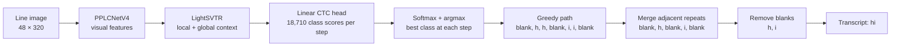

# PP-OCRv6 JAX fine-tuning algorithm

This document describes the algorithm that the current RxHandBD fine-tuning runner actually executes. The implementation is in [`src/ocrax/application/training.py`](../src/ocrax/application/training.py), with input preparation in [`src/ocrax/infrastructure/data/manifests.py`](../src/ocrax/infrastructure/data/manifests.py) and the Flax NNX recognition network in [`src/ocrax/infrastructure/models/ppocrv6.py`](../src/ocrax/infrastructure/models/ppocrv6.py).

## PP-OCRv6 text recognition architecture

PP-OCRv6 treats recognition as transcription of a cropped text line. The [PP-OCRv6 paper](https://arxiv.org/abs/2606.13108) presents the broader OCR system and its recognition design; the implementation used in this document is the medium recognizer's CTC path. At a high level, the data pipeline converts each crop to a normalized line image, a visual backbone extracts features, a sequence neck combines neighboring and line-wide evidence, and a linear classifier predicts character classes at each horizontal position. [CTC](https://www.cs.toronto.edu/~graves/icml_2006.pdf) turns those framewise scores into a transcript without requiring character boxes or character-level alignment labels.

The code-level flow is:

```text
RGB crop → BGR, resize to height 48, cap/pad width to 320, scale to [-1, 1]
          → PPLCNetV4 backbone → LightSVTR neck → CTC class scores → decode text
```

The exact resize and padding rules are described in [Data and image transformation](#data-and-image-transformation). For this fine-tuning run, the fixed input tensor is $[B,3,48,320]$. The sequence axis corresponds to the image's horizontal direction; the vertical feature dimension is collapsed before the CTC classifier.

### 1. PPLCNetV4 visual backbone

The backbone converts pixels into a spatial feature map. Its stem and stages use convolutional blocks with depthwise spatial filtering and pointwise channel mixing. Blocks expand the channel dimension, apply nonlinear feature processing, and project back; selected blocks add a residual path and [squeeze-and-excitation](https://openaccess.thecvf.com/content_cvpr_2018/html/Hu_Squeeze-and-Excitation_Networks_CVPR_2018_paper.html) channel recalibration. In the medium configuration represented in [`model.py`](../src/ocrax/infrastructure/models/ppocrv6.py), the stages progress through 128, 256, 512, and 768 channels. The final visual features have 768 channels.

The design reason is a practical tradeoff: convolutions build local stroke and shape features efficiently, while depthwise filtering separates spatial filtering from channel mixing to control computation, as in [MobileNets](https://arxiv.org/abs/1704.04861). The [PP-OCRv6 paper](https://arxiv.org/abs/2606.13108) presents its LCNetV4 family as a lightweight, reparameterizable visual backbone for OCR deployment tiers. The SE component adds global channel recalibration at selected points; the original [SE Networks paper](https://openaccess.thecvf.com/content_cvpr_2018/html/Hu_Squeeze-and-Excitation_Networks_CVPR_2018_paper.html) motivates this by modeling dependencies among feature channels. These papers motivate the design family; they do not establish that each block is independently optimal for RxHandBD.

Downsampling must also respect text geometry. The stages shrink the feature map while retaining substantially more horizontal than vertical resolution, so the network reduces redundant image detail without discarding the left-to-right order needed for transcription. At the end, the model pools the feature map to one row and preserves a sequence across width. This is why the backbone is configured for recognition rather than using a generic image-classification head that would collapse both spatial dimensions into one class prediction.

### 2. LightSVTR sequence neck

The neck receives the 768-channel feature map and projects it to 192 channels. It first applies a depthwise $1\times7$ horizontal convolution and adds that local response to the projected features. It then reshapes the row of features into a sequence and applies two global self-attention blocks. Each block can combine evidence from distant positions in the line; the neck layer-normalizes the result and adds a separately projected skip connection from the backbone features.

The motivation comes from the [SVTR paper](https://arxiv.org/abs/2205.00159): its central idea is to model character components with local and global visual mixing, avoiding a separate recurrent sequence model. In this implementation, the horizontal convolution gives a local path for adjacent-stroke and character patterns, while attention supplies wider context for ambiguous shapes and spacing. The smaller 192-dimensional neck and two-block depth are the LightSVTR configuration in the [PP-OCRv6 paper](https://arxiv.org/abs/2606.13108), providing a compact context-mixing stage after the higher-channel CNN.

This gives each position both visual detail and line-level context, but the features remain visual. The neck is not a language model and does not explicitly enforce word or sentence grammar. Later work on [SVTRv2](https://arxiv.org/abs/2411.15858) notes that CTC recognizers can struggle with irregular text and missing linguistic context, and proposes additional mechanisms for those cases. Those SVTRv2 mechanisms are not present in this port.

### 3. CTC classifier and decoding

After the neck returns a single feature row, a linear layer maps each 192-dimensional position to 18,710 classes: the blank class plus the configured character dictionary. During training the model returns logits for the CTC loss. During inference it applies softmax and the greedy decoder selects the most likely class at each position, merges adjacent duplicate IDs, removes blanks, and maps the remaining IDs to characters.



The repeated `h` and `i` predictions collapse to one character each. If two equal characters are separated by a blank, as in `l, blank, l`, they remain two characters after collapsing, so the transcript can contain `ll`.

CTC is suited to line transcription because the training data gives a whole-line transcript, not a timestamp or x-coordinate for every character. As introduced by [Graves et al.](https://www.cs.toronto.edu/~graves/icml_2006.pdf), CTC defines a collapse operation over framewise paths and sums the probabilities of all paths that yield the target string. The blank symbol separates repeated characters when needed, so the model can learn alignments from the transcript alone. Greedy decoding is inexpensive and matches this runner's implementation; it does not search alternative paths with a beam or use an external lexicon or language model.

The current JAX training path adaptively pools the backbone output to exactly 40 horizontal positions. The inference path instead uses the checkpoint's valid average pooling and can produce a sequence length determined by input width. In the training loss, all 40 positions are marked valid, including positions that may correspond to right-padded image regions. That is a property of this implementation and a possible source of avoidable alignment noise for narrow images.

### Why this combination is used

Together, the CNN backbone, visual context neck, and CTC head form a recognizer designed to be compact and fast while preserving a sequence output aligned with the text line. The backbone handles efficient local feature extraction; LightSVTR adds nonlocal visual context without a recurrent decoder; CTC learns a transcript from unsegmented line labels and uses a simple framewise classifier. The [SVTR work](https://arxiv.org/abs/2205.00159) supports local/global visual modeling for scene text, while the [PP-OCRv6 paper](https://arxiv.org/abs/2606.13108) applies a lightweight architecture family to OCR system tiers. This is the literature-based rationale for the architecture, rather than a claim that this particular RxHandBD fine-tuning setup has been compared against every alternative.

The repository ports the inference checkpoint's CTC branch. The original PP-OCRv6 recognition configuration also describes a separate NRTR auxiliary training decoder, but that decoder is not available in the converted inference artifact. Consequently, this fine-tuning run optimizes CTC alone; it does not reproduce the full CTC+NRTR training objective.

## What is being fine-tuned

The model is PP-OCRv6 medium recognition, initialized from a Paddle inference checkpoint converted to Flax NNX and saved in Orbax format. The JAX network maps an image batch $X$ to CTC logits

\[
  f_\theta(X) = Z \in \mathbb{R}^{B\times T\times C},
  \qquad T=40,\quad C=18{,}710,
\]

where $B$ is batch size, $T$ is the recognizer's fixed sequence length, and $C$ is the output vocabulary size. Class 0 is the CTC blank; dictionary characters (including the appended space token) occupy the other class IDs. The computation is image → PPLCNetV4 recognition backbone → LightSVTR neck → one CTC linear projection. During training, the backbone uses the implementation's adaptive pooling path to produce 40 sequence positions; the neck turns the feature map into a sequence and the CTC layer produces per-time-step logits.

This is **CTC-only continued training**. The available converted artifact is an inference checkpoint; it has no NRTR auxiliary training decoder. The current implementation therefore does not optimize the official multi-head CTC+NRTR objective. It keeps the pretrained CTC vocabulary and output layer intact.

## Data and image transformation

Training and validation examples are read from JSONL manifests containing an image path and transcript. The split is prepared from RxHandBD training labels; the training program does not read test labels. Each image is decoded as RGB, converted to BGR to match PaddleOCR's decoder, resized to height $48$ while preserving aspect ratio, capped at width $320$, and right-padded to width $320$. Pixel values are scaled to $[-1,1]$:

\[
  x' = 2\frac{x}{255} - 1.
\]

The resulting tensor is CHW, so the model input shape is $[B,3,48,320]$. The resizer computes

\[
  w_r = \min\left(320,\max\left(1,\left\lceil 48\frac{w}{h}\right\rceil\right)\right),
\]

then pads the $48\times w_r$ resized image on the right. The model's current training path pools to $T=40$; it does not pass per-example $w_r$ values to CTC. Consequently every output position is treated as a valid timestep, including positions corresponding to right padding.

On training batches only, brightness and contrast are independently sampled uniformly from $[0.9,1.1]$. These are mild photometric perturbations; there is no geometric augmentation in this runner. Validation uses the unmodified image transform.

For a target transcript $y=(y_1,\ldots,y_U)$, each character maps to its pretrained dictionary ID. The minibatch target matrix is padded to the longest target in that minibatch. A parallel mask is zero on real target characters and one on padding positions. This target padding mask is consumed by Optax's CTC loss. A character outside the configured dictionary raises an error rather than being dropped or mapped to an unknown token.

## CTC objective

For image $x_i$, let $z_{i,t,c}$ be its logit for class $c$ at timestep $t$. The per-timestep distribution is

\[
  p_{i,t,c}=\operatorname{softmax}(z_{i,t,:})_c
  =\frac{\exp(z_{i,t,c})}{\sum_{k=0}^{C-1}\exp(z_{i,t,k})}.
\]

CTC maps a length-$T$ path π of classes to a shorter output by first merging consecutive repeated tokens and then removing blanks. For transcript $y_i$, let $\mathcal{B}^{-1}(y_i)$ denote all paths that collapse to that transcript. The conditional probability and negative log-likelihood are

\[
  P(y_i\mid x_i)=\sum_{\pi\in\mathcal{B}^{-1}(y_i)}
       \prod_{t=1}^{T}p_{i,t,\pi_t},
  \qquad
  \ell_i=-\log P(y_i\mid x_i).
\]

The sum over alignments is evaluated by the CTC dynamic program (implemented by `optax.ctc_loss`), not by enumerating paths; this is the forward-backward computation described in the [original CTC paper](https://www.cs.toronto.edu/~graves/icml_2006.pdf). Blank ID is explicitly set to 0. The trainer supplies all-zero logit paddings, meaning every one of the 40 timesteps is considered valid. The minibatch objective is the mean of the per-example CTC losses:

\[
  L_B(\theta)=\frac{1}{B}\sum_{i=1}^{B}\ell_i(\theta).
\]

No NRTR loss, label smoothing, auxiliary loss weighting, or validation-derived loss scaling is applied.

## Gradient and parameter update

JAX differentiates the minibatch objective with respect to the NNX model parameters. Before AdamW, gradients are clipped by their global Euclidean norm. For the flattened parameter gradient $g$, the clipped gradient is

\[
  \tilde g = g\,\min\left(1,\frac{1}{\lVert g\rVert_2}\right).
\]

Thus gradients with norm at most 1 remain unchanged; larger gradients are scaled to norm 1, following the gradient-norm clipping approach described by [Pascanu et al.](https://proceedings.mlr.press/v28/pascanu13.html). Optax AdamW then maintains first and second moments; Adam's moment estimates originate in [Kingma and Ba](https://arxiv.org/abs/1412.6980), while the decoupled weight-decay variant is described by [Loshchilov and Hutter](https://arxiv.org/abs/1711.05101).

\[
  m_t=\beta_1m_{t-1}+(1-\beta_1)\tilde g_t,\qquad
  v_t=\beta_2v_{t-1}+(1-\beta_2)\tilde g_t^2,
\]

with bias-corrected estimates $\hat m_t=m_t/(1-\beta_1^t)$ and $\hat v_t=v_t/(1-\beta_2^t)$. The parameter update is

\[
  \theta_{t+1}=\theta_t-\eta\left(
    \frac{\hat m_t}{\sqrt{\hat v_t}+\epsilon}+\lambda\theta_t
  \right),
\]

where the runner defaults to learning rate $\eta=10^{-5}$ and decoupled weight decay $\lambda=10^{-5}$. The optimizer transformation is global-norm clipping followed by AdamW. No learning-rate schedule is configured, so the learning rate stays constant throughout the run. The default minibatch size is 8. All model parameters are included in optimization (`wrt=nnx.Param`); this is full-model fine-tuning, not a frozen-backbone procedure.

### Parameters updated during fine-tuning

The training code differentiates the CTC loss with respect to the full model and constructs the optimizer with `wrt=nnx.Param`. There is no parameter filter, frozen layer, or separate learning rate by component. Starting from the converted pretrained checkpoint, AdamW can therefore change the following learned values:

| Component | Parameters updated |
| --- | --- |
| PPLCNetV4 backbone | Convolution kernels and biases throughout the stem and stages; the squeeze-and-excitation layers' projection kernels and biases; and the scale and offset parameters of BatchNorm layers. This includes the residual and reparameterized depthwise blocks. |
| LightSVTR neck | The 768-to-192 channel projections, depthwise horizontal-convolution parameters, attention query/key/value and output projections, both MLP layers in each attention block, LayerNorm scale and offset parameters, and the projected skip path. |
| CTC output layer | The final linear projection's weights and bias for all 18,710 classes, including blank and the existing character IDs. |

AdamW applies the same configured learning rate and weight decay across this parameter set. The character dictionary and class-to-character mapping are fixed data, not learned parameters; fine-tuning changes the scores assigned to their existing IDs rather than changing the vocabulary.

Pooling, activations, softmax, and greedy CTC decoding have no learned parameters. BatchNorm running means and variances are also not updated: the conversion initializes these state values to represent identity BatchNorm after folding the source transformations into the convolution parameters, and the forward pass uses running averages. The trainable BatchNorm scale and offset remain `Param` values, distinct from those frozen running statistics. The converted artifact contains no NRTR auxiliary decoder, so there are no NRTR parameters in this optimization.

### Batch-normalization state

The Paddle inference conversion folds the source BatchNorm transformations into convolution weights and biases, representing these layers with identity BatchNorm state. Batch normalization was introduced by [Ioffe and Szegedy](https://proceedings.mlr.press/v37/ioffe15.html). The JAX model therefore uses running averages when calling these layers and does not update running statistics from minibatches. This preserves the converted inference semantics while convolution and other trainable parameters continue to receive gradients. It is not equivalent to re-estimating BatchNorm statistics on RxHandBD.

## Epoch sampling and reproducibility

At each epoch, training example indices are shuffled with Python's RNG seeded by `seed + epoch` (zero-based epoch index). The per-batch image augmentation RNG is seeded by `seed + epoch * 100000 + batch_index`. The default base seed is `20261017`. The final batch may be smaller than the configured batch size. These choices make ordering and photometric augmentation deterministic for a fixed manifest, software stack, and seed. They do not guarantee bitwise reproducibility across different accelerators or library versions.

## Validation and checkpoint selection

At startup the unmodified initialization checkpoint is evaluated on the validation manifest and saved as the initial best candidate. At each epoch's end, the trainer evaluates the current model with augmentation disabled. It computes:

* Mean CTC loss per validation sample.
* Character error rate (CER), aggregating Levenshtein edit distance across examples:

  \[
    \mathrm{CER}=\frac{\sum_i d_{\mathrm{Lev}}(\hat y_i,y_i)}
                       {\max(1,\sum_i |y_i|)}.
  \]

* Raw exact-match rate, the fraction of predictions exactly equal to the reference strings.

Predictions use greedy CTC decoding: choose the most probable class at each timestep, merge adjacent equal IDs, remove blank IDs, and map remaining IDs to characters. This is not beam search or language-model decoding.

An epoch becomes the best checkpoint only if its validation CER is lower than the previous best by more than `min_delta`:

\[
  \mathrm{CER}_{new}<\mathrm{CER}_{best}-\delta.
\]

The default $\delta=0.001$. If the condition holds, the model checkpoint is replaced and the no-improvement counter resets. Otherwise that counter increments. Training stops when it reaches `patience` consecutive epochs (default 3). Since the starting checkpoint is saved before training, the returned checkpoint cannot have worse validation CER than the initialization under this selection rule. Epoch count defaults to 3. `finetuning.json` stores data manifest hashes, parameters, per-epoch results, baseline and best validation metrics, and the selected checkpoint source.

## End-to-end algorithm

For clarity, the complete procedure is:

1. Load the character dictionary and train/validation manifests; restore the converted NNX checkpoint.
2. Construct AdamW with global norm clipping; evaluate and checkpoint the starting model.
3. For each epoch, shuffle training examples; for every minibatch, decode and resize images, apply brightness/contrast perturbations, encode transcripts, compute mean CTC loss, backpropagate, clip gradients, and update parameters.
4. Evaluate the epoch model on clean validation inputs; update the best checkpoint only after a CER improvement exceeding `min_delta`.
5. Stop at the epoch limit or after `patience` non-improving epochs, and write run metadata.

In pseudocode:

```text
best = evaluate_CER(initial_model)
save(initial_model)
stale = 0
for epoch in 0 .. epochs-1:
    for batch in deterministic_shuffle(train, seed + epoch):
        X, Y = preprocess_and_augment(batch)
        loss = mean(CTC_NLL(model(X), Y))
        g = grad(loss, model.parameters)
        g = clip_global_norm(g, 1.0)
        model.parameters = AdamW(model.parameters, g, lr, weight_decay)
    metrics = evaluate(model, validation)
    if metrics.CER < best.CER - min_delta:
        best = metrics
        save(model)
        stale = 0
    else:
        stale += 1
    if stale >= patience:
        break
```

## Interpretation and limitations

The implementation adapts the pretrained visual sequence recognizer to the RxHandBD handwriting domain using a CTC transcription objective. It does not train text detection, alter the vocabulary, use an external language model, optimize the NRTR auxiliary decoder, or tune on the held-out test set. The current sample-level split has no writer/source grouping field, so validation CER can be optimistic when related handwriting or source material appears in both partitions. Also, treating all 40 output positions as valid means padded image regions can contribute to CTC alignments. These are properties of the current algorithm and should be considered when comparing it with PaddleOCR's official training pipeline or designing a subsequent experiment.
